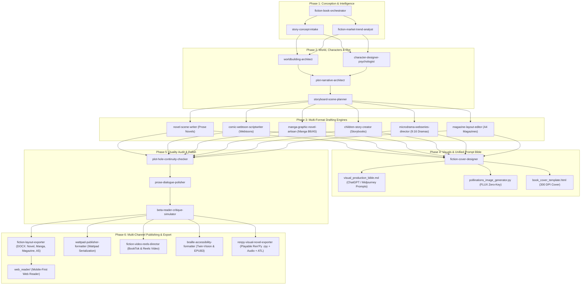
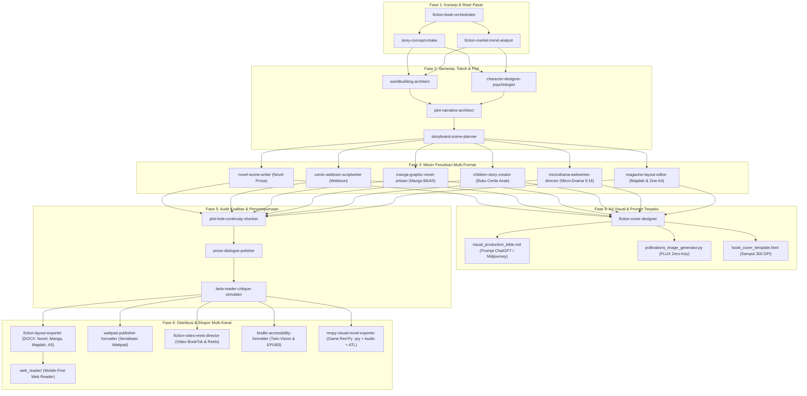

# Fiction Book Agent Skills

> Bilingual single-file README. Jump to language: [English](#english) | [Bahasa Indonesia](#bahasa-indonesia)

[](https://github.com/lensetek/Fiction-book-agent-skills)
[](LICENSE)
[](https://github.com/lensetek/Fiction-book-agent-skills)

---

## English

### Overview
**Fiction Book Agent Skills** is a specialized collection of 23 AI agent skills designed for authoring **novels**, **fiction books**, **manga & comic graphic novels**, **interactive Ren'Py visual novels**, **children's picture books**, **editorial magazines & zines**, **Wattpad web-novels**, **vertical micro-dramas (TikTok/Reels/ReelShort)**, and **inclusive Braille accessibility books**. Built on an **orchestrator + specialist agents** pattern, it guides authors from initial high-concept ideas, real-time market trend research, and worldbuilding to character psychology, 3-act narrative architecture, scene drafting, dynamic manga/comic framing (slanted cuts, frame-breaking, double-page splash), Ren'Py visual novel scripting (branching menus, ATL animations, BGM/SFX audio cue sheets), magazine editorial layouts (A4 multi-column, mastheads, pull-quotes), storybook formatting, Braille conversion, continuity checking, All-In-One Visual Production Bible (`visual_production_bible.md`), Zero-Key AI image generation (Pollinations FLUX), cover design specifications, Wattpad web-novel serialization, vertical micro-drama directing, automated daily updates, and publisher-grade print/digital layout export (including PT. Asadel Liamsindo Teknologi & Asadel Publisher presets).

### Installation

#### 1. Global Installation for AI Agents (One-Prompt Universal Setup)
Copy and paste this instruction directly into your AI Assistant prompt (Google Antigravity, Claude Code, Cursor, Codex, ChatGPT) to install these skills **globally** so they are available across all your fiction projects:

```text
Please install and register the Fiction Book Agent Skills globally from https://github.com/lensetek/Fiction-book-agent-skills so they are accessible across all my creative writing and fiction projects.
```

> **For `npx skills` users (Global Flag)**:
> ```bash
> npx skills add https://github.com/lensetek/Fiction-book-agent-skills -g
> ```

#### 2. Project-Local CLI Installation
To install only for the current workspace/repository:

```bash
npx skills add https://github.com/lensetek/Fiction-book-agent-skills
```

#### 3. Direct Repository URL Reference
Or link the repository directly in your assistant prompt:

```text
https://github.com/lensetek/Fiction-book-agent-skills
```

---

### End-to-End Workflow Architecture



---

### Agent Taxonomy (23 Specialist Skills)

| Agent / Skill | Description | Main Tasks | Main Output |
| :--- | :--- | :--- | :--- |
| `fiction-book-orchestrator` | Master workflow manager for fiction projects. | Project intake, routing specialist agents, manuscript coordination. | Combined fiction manuscript & project plan. |
| `story-concept-intake` | Refines core story ideas & premise. | Genre, sub-genre, 1-sentence logline, tropes, and moral theme. | `story_brief.md` |
| `fiction-market-trend-analyst` | Real-time web trend & trope researcher. | Live BookTok/Webtoon/KDP research, title generation, search tags, reference benchmarks. | `market_research_report.md` |
| `worldbuilding-architect` | Designs physical setting & world rules. | Magic/tech systems, geography, factions, sensory ambience. | `worldbuilding_codex.md` |
| `character-designer-psychologist` | Crafts deep character psychology. | Want vs Need, fatal flaw, trauma backstory, character arcs, dialogue voices. | `character_sheets/` |
| `plot-narrative-architect` | Structures story plot architecture. | Save the Cat, 3-Act Structure, Hero's Journey, subplots, foreshadowing map. | `plot_outline.md` |
| `storyboard-scene-planner` | Breaks chapters into scene beats. | Goal, Conflict, Disaster, Reaction, Dilemma, Decision (Swain's Method). | `scene_breakdown.md` |
| `novel-scene-writer` | Drafts rich narrative chapter prose. | "Show, Don't Tell" prose, 5-sensory palette, natural dialogue. | `chapters/chapter_01.md` |
| `comic-webtoon-scriptwriter` | Writes comic & vertical webtoon panel scripts. | Panel breakdown, camera angles, speech balloons, SFX, AI image prompts. | `comic_script.md` |
| `children-story-creator` | Authors children's picture books & fables. | Rhyming prose, age-appropriate vocabulary, page spreads, illustration briefs. | `children_storybook.md` |
| `braille-accessibility-formatter` | Formats books for blind & visually impaired readers. | Twin-Vision Braille Interlined (`⠁⠃⠉`), Audio-Tactile QR Bridges, Braille Embosser export, & EPUB3 accessibility. | `accessibility_plan.md` |
| `plot-hole-continuity-checker` | Audits narrative continuity & plot holes. | Timeline consistency, worldbuilding rule enforcement, character behavior integrity. | `continuity_report.md` |
| `prose-dialogue-polisher` | Polishes prose rhythm & dialogue subtext. | Trims purple prose, aligns character voice, refines dialogue tags. | `chapters_polished/` |
| `beta-reader-critique-simulator` | Simulates target demographic beta feedback. | Evaluates pacing, first-chapter hook, emotional payoff per reader persona. | `beta_reader_feedback.md` |
| `fiction-layout-exporter` | Formats print & digital e-book exports. | Publisher-grade DOCX (Asadel ID/INTL, Novel 13x19 cm, Manga B6, Square, A5, A4) + Mobile Web Reader. | `build/*.docx` & `web_reader/` |
| `fiction-agent-update-manager` | Automated Git update & security manager. | Pre-update credential leak scanning, guarded `git pull` confirmation, & daily cron checks. | Remote repo update status & prompt alerts. |
| `fiction-cover-designer` | Book cover, spine math, & AI prompt designer. | Front/back cover layouts, spine width calculations, typography, safe-area preflight, & AI image prompts. | Cover brief & image prompts. |
| `wattpad-publisher-formatter` | Wattpad web-novel episode serializer & tagger. | Episode splitting (1,500-2,500 words), cliffhanger check, 25 Wattpad search tags, A/N Vote ⭐ prompts, & 2:3 cover specs. | `wattpad_build/*.md` & setup metadata. |
| `fiction-video-reels-director` | Short video reels & micro-drama director. | 3-second viral hooks, 9:16 vertical scene breakdowns, Google Flow/Veo video prompts, Indonesian VO script, & dynamic captions. | `reels_production/*.md` |
| `manga-graphic-novel-artisan` | Japanese Manga & Graphic Novel specialist. | Tankobon B6/A5 sizes, dynamic slanted cuts, frame-breaking, double-page splash, screentone B&W, & negative space for balloons. | `manga_production/*.md` |
| `microdrama-webseries-director` | Vertical 9:16 micro-drama web series director. | 60-90s episode beats (Hook, micro-twist, extreme cliffhanger), safe UI zone, character consistency, & keyframe visual prompts. | `microdrama_production/*.md` |
| `magazine-layout-editor` | Editorial magazine & creative zine editor. | A4/US Letter multi-column grids, masthead cover anatomy, teasers, pull-quotes, drop-caps, & high-fashion editorial photo prompts. | `magazine_production/*.md` |
| `renpy-visual-novel-exporter` | Interactive Ren'Py Visual Novel game exporter. | Dialogue-to-syntax conversion, branching choice menus (`menu:`), ATL animation transforms, BGM/SFX audio cue sheets, & asset manifests. | `renpy_build/game/*.rpy` |

---

## Bahasa Indonesia

### Ringkasan
**Fiction Book Agent Skills** adalah koleksi 23 *AI Agent Skills* khusus untuk penulisan **novel**, **buku fiksi**, **manga & komik graphic novel**, **game visual novel interaktif Ren'Py**, **buku cerita anak bergambar**, **majalah editorial & zine**, **web-novel Wattpad**, **serial micro-drama vertikal (TikTok/Reels/ReelShort)**, dan **buku aksesibilitas Braille inklusif**. Menggunakan pola **orchestrator + spesialis**, repositori ini memandu penulis dari ide kasar, riset pasar & tren fiksi live di internet, perancangan dunia (*worldbuilding*), psikologi tokoh, arsitektur plot (3-Act / Save the Cat), penulisan adegan *"Show, Don't Tell"*, tata letak bingkai manga dinamis (*slanted cuts, frame-breaking, double-page splash*), penulisan script game visual novel Ren'Py (menu pilihan percabangan, animasi ATL sprite, audio cue BGM/SFX), tata letak majalah multi-kolom (A4/US Letter, masthead, pull-quotes), skrip panel komik & prompt AI, buku cerita anak berima, konversi Braille & Audio QR, audit kontinuitas garis waktu, desain sampul & perhitungan punggung buku, kit visual terpadu (*Visual Production Bible*), generator gambar gratis tanpa kunci (Pollinations FLUX), serialisasi Wattpad & pemicu Vote ⭐/Komentar, sutradara micro-drama vertikal 9:16, pemantauan pembaruan otomatis harian, hingga ekspor tata letak **buku cetak fisik** (preset PT. Asadel Liamsindo Teknologi & Asadel Publisher) maupun **e-book digital**.

### Panduan Instalasi

#### 1. Instalasi Global untuk AI Agent (Prompt Universal Siap Salin)
Salin instruksi prompt di bawah ini langsung ke prompt AI Assistant Anda (Google Antigravity, Claude Code, Cursor, Codex, ChatGPT) untuk memasang skills ini secara **global** agar dapat digunakan di semua proyek fiksi Anda:

```text
Tolong install dan daftarkan Fiction Book Agent Skills secara global dari https://github.com/lensetek/Fiction-book-agent-skills agar dapat digunakan di seluruh proyek penulisan cerita dan fiksi saya.
```

> **Untuk pengguna `npx skills` (Flag Global)**:
> ```bash
> npx skills add https://github.com/lensetek/Fiction-book-agent-skills -g
> ```

#### 2. Instalasi Lokal per Direktori Proyek (CLI)
Jika hanya ingin memasang pada folder/workspace proyek yang aktif saat ini:

```bash
npx skills add https://github.com/lensetek/Fiction-book-agent-skills
```

#### 3. Referensi Tautan Prompt Langsung
Atau cukup salin URL repositori ke prompt asisten AI:

```text
https://github.com/lensetek/Fiction-book-agent-skills
```

---

### Alur Kerja & Arsitektur End-to-End



---

### Daftar Agen & Spesialisasi (23 Skills)

| Agent / Skill | Deskripsi | Tugas Utama | Output Utama |
| :--- | :--- | :--- | :--- |
| `fiction-book-orchestrator` | Koordinator utama alur proyek fiksi. | Intake, routing spesialis, koordinasi bab, pemeriksaan akhir. | Alur kerja proyek fiksi & gabungan naskah. |
| `story-concept-intake` | Menggali & mematangkan ide cerita fiksi. | Genre, sub-genre, *logline* 1 kalimat, *trope*, dan tema moral. | `story_brief.md` |
| `fiction-market-trend-analyst` | Riset tren fiksi & judul live di internet. | Riset BookTok/Webtoon/KDP live, formulasi judul, *tags*, benchmark cerita pembanding. | `market_research_report.md` |
| `worldbuilding-architect` | Merancang dunia & aturan fiksi (*worldbuilding*). | Sistem sihir/teknologi, geografi, faksi, lanskap sensori. | `worldbuilding_codex.md` |
| `character-designer-psychologist` | Merancang profil psikologis tokoh. | *Want vs Need*, *fatal flaw*, luka trauma, *character arc*, gaya dialog. | `character_sheets/` |
| `plot-narrative-architect` | Menyusun arsitektur plot cerita. | Kerangka *Save the Cat*, 3-Act, *Hero's Journey*, *subplot*, *foreshadowing*. | `plot_outline.md` |
| `storyboard-scene-planner` | Memecah bab menjadi *Scene Beats*. | *Goal, Conflict, Disaster, Reaction, Dilemma, Decision* (Swain's Method). | `scene_breakdown.md` |
| `novel-scene-writer` | Menulis draf prosa adegan. | Penulisan adegan *"Show, Don't Tell"*, detail sensori (5 indra), dialog alami. | `chapters/chapter_01.md` |
| `comic-webtoon-scriptwriter` | Menulis skrip komik & webtoon vertikal. | Pemecahan panel, sudut kamera, dialog balon, SFX, prompt AI gambar. | `comic_script.md` |
| `children-story-creator` | Menulis buku cerita anak & fabel. | Teks cerita berima per halaman, *brief* ilustrasi, kalibrasi kelompok usia. | `children_storybook.md` |
| `braille-accessibility-formatter` | Format buku cetak & digital ramah tunanetra. | Twin-Vision Braille Interlined (`⠁⠃⠉`), Audio-Tactile QR Bridges, ekspor Braille Embosser, & EPUB3 accessible. | `accessibility_plan.md` |
| `plot-hole-continuity-checker` | Audit kontinuitas & lubang plot. | Memeriksa garis waktu (*timeline*), aturan dunia, & *character behavior integrity*. | `continuity_report.md` |
| `prose-dialogue-polisher` | Menyunting gaya prosa & dialog. | Memangkas *purple prose*, menyelaraskan *character voice*, menghaluskan dialog. | `chapters_polished/` |
| `beta-reader-critique-simulator` | Mensimulasikan umpan balik pembaca target. | Evaluasi *pacing*, daya pikat (*hook*), & *emotional payoff* per persona pembaca. | `beta_reader_feedback.md` |
| `fiction-layout-exporter` | Penata letak **Buku Cetak** & **Digital**. | Ekspor `.docx` siap cetak (Preset Asadel ID/INTL, Novel 13x19 cm, Manga B6, Square, A5, A4) + Mobile Web Reader. | `build/*.docx` & `web_reader/` |
| `fiction-agent-update-manager` | Pengelola pembaruan Git & keamanan otomatis. | Pemindaian kebocoran kredensial, notifikasi persetujuan `git pull`, & jadwal cron harian. | Status update remote repo & prompt persetujuan. |
| `fiction-cover-designer` | Perancang sampul buku, punggung, & prompt AI. | Layout cover depan/belakang, rumus lebar punggung buku, tipografi, preflight cetak, & prompt gambar AI. | Brief cover & prompt gambar AI. |
| `wattpad-publisher-formatter` | Penata & serialisasi web-novel Wattpad. | Pemecahan episode (1.500-2.500 kata), pemicu cliffhanger, 25 tag rekomendasi, A/N pemicu Vote ⭐, & cover 2:3. | `wattpad_build/*.md` & metadata setup. |
| `fiction-video-reels-director` | Sutradara video reels & micro-drama vertikal. | Hook 3 detik viral, breakdown adegan vertikal 9:16, prompt video Google Flow/Veo, naskah VO Indonesia, & subtitle dinamis. | `reels_production/*.md` |
| `manga-graphic-novel-artisan` | Spesialis Manga Jepang & Graphic Novel. | Standar Tankobon B6/A5, framing miring aksi, efek tembus panel, double-page splash, screentone B&W, & negative space balon kata. | `manga_production/*.md` |
| `microdrama-webseries-director` | Sutradara serial micro-drama vertikal 9:16. | Struktur episode 60-90 detik (Hook, micro-twist, cliffhanger ekstrem), safe UI zone, konsistensi aktor, & keyframe visual AI. | `microdrama_production/*.md` |
| `magazine-layout-editor` | Editor tata letak majalah & zine editorial. | Grid 2-3 kolom A4/US Letter, anatomi cover masthead, teasers, pull-quotes, drop-caps, & prompt foto editorial majalah. | `magazine_production/*.md` |
| `renpy-visual-novel-exporter` | Eksportir game Visual Novel interaktif Ren'Py. | Konversi dialog ke syntax `.rpy`, menu pilihan bercabang (`menu:`), animasi ATL gerak sprite, cue audio BGM/SFX, & manifes aset. | `renpy_build/game/*.rpy` |

---

## What's New in v1.9.0 (Changelog)

### 🌟 English
- **New Skill: `renpy-visual-novel-exporter`**:
  - Full automated conversion of fiction manuscripts, narrative beats, and dialogues into ready-to-run **Ren'Py Visual Novel scripts** (`.rpy`).
  - Interactive branching narrative support via `menu:` choice blocks with player state flags (e.g., affection points, discovery flags).
  - Built-in audio management: Background music transitions (`play music ... fadein 2.0 loop`), sound effects (`play sound ...`), and ambient environmental audio.
  - Ren'Py Animation and Transformation Language (ATL) transforms: Smooth stage entrance/exit (`masuk_dari_kiri`, `masuk_dari_kanan`), startled jumps (`lompat_kaget`), idle breathing, and screen transitions (`with dissolve`, `with vpunch`, `with hpunch`).
  - Complete output package: `script.rpy`, `definitions.rpy`, `transforms.rpy`, and `asset_manifest.md` (AI prompt specs for background art, character sprite emotions, and Suno/Udio BGM generation).
- **Python Helper Utility (`helpers/python/export_to_renpy.py`)**:
  - Standalone script parser that extracts characters, dialogue lines, emotions, background changes, sound cues, and interactive choices into game-engine compliant Ren'Py files.

### 🌟 Bahasa Indonesia
- **Skill Baru: `renpy-visual-novel-exporter`**:
  - Konversi otomatis naskah fiksi, dialog adegan, dan papan cerita menjadi skrip game **Visual Novel Ren'Py** (`.rpy`) siap main.
  - Dukungan narasi interaktif bercabang melalui blok `menu:` pilihan pemain dan variabel state permainan (poin kedekatan tokoh, pencarian petunjuk).
  - Tata kelola audio terpadu: Musik latar bersambung halus (`play music ... fadein 2.0 loop`), efek suara aksi (`play sound ...`), dan suara atmosfer lingkungan.
  - Animasi visual ATL (*Animation and Transformation Language*): Pergerakan sprite masuk/keluar panggung, animasi karakter kaget melompat (`lompat_kaget`), nafas idle, serta efek guncangan layar benturan (`with hpunch`, `with vpunch`).
  - Paket berkas lengkap: `script.rpy`, `definitions.rpy`, `transforms.rpy`, dan `asset_manifest.md` (panduan prompt gambar background, ekspresi sprite tokoh, dan musik BGM).
- **Utilitas Generator Python (`helpers/python/export_to_renpy.py`)**:
  - Skrip parser mandiri untuk mengekstraksi naskah Markdown menjadi berkas Ren'Py terstruktur tanpa konfigurasi manual.

---

## What's New in v1.8.0 (Changelog)

### 🌟 English
- **New Skill: `manga-graphic-novel-artisan`**:
  - Dedicated Japanese Manga & Graphic Novel formatting adhering to Tankobon B6 (128×182 mm) and A5 (148×210 mm) publication trim standards.
  - Dynamic panel architecture: slanted diagonal cuts for high-action impact, frame-breaking character pop-outs (*tachi-kiri* bleed), 2-page dramatic splash spreads, and dedicated negative space planning for speech balloons and SFX lettering.
  - Screentone B&W halftone shading prompts tailored specifically for native image-generating models (ChatGPT DALL-E 3, Gemini Antigravity, Midjourney).
- **New Skill: `microdrama-webseries-director`**:
  - Complete directorial scriptwriting and visual staging for ultra-short 9:16 vertical drama series (TikTok, Instagram Reels, YouTube Shorts, ReelShort, DramaBox).
  - Engineered with 3-second instant hook formulas, rapid 60–90 second episodic pacing, micro-twists, and extreme cliffhangers.
  - Safe UI Zone mapping (1080×1920 px viewport protection against TikTok/Reels side buttons and bottom captions) and multi-shot keyframe prompts for AI image & video engines (Google Flow, Veo, Kling).
- **New Skill: `magazine-layout-editor`**:
  - Editorial magazine and zine publishing system featuring 2-column and 3-column typographic grids (A4 210×297 mm & US Letter).
  - Complete cover anatomy design: Top Masthead branding, issue dateline, lead feature headline, and teaser sub-headlines.
  - Editorial styling elements including dramatic pull-quotes, 3-line drop-caps, photo caption sidebars, and high-fashion editorial photography prompts.
- **Direct AI Model Prompting in All-In-One Visual Bible (`visual_production_bible.md`)**:
  - Consolidated single-file prompt master codex enabling authors to copy and paste ready-to-run prompts directly into image-capable AI models (ChatGPT, Gemini, Midjourney).
  - Guarantees character facial consistency across 3-angle turnaround sheets (Front, 3/4, Profile), cover art, interior scenes, and manga panel framing in a single file.
- **Enhanced Print Presets in Word DOCX Exporter**:
  - Native print presets added to [`helpers/python/generate_fiction_docx.py`](helpers/python/generate_fiction_docx.py):
    - `manga_b6` (128 × 182 mm Tankobon with 1.8 cm gutter)
    - `storybook_square` (200 × 200 mm for children's picture books)
    - `magazine_a4` (210 × 297 mm with 3-column editorial layout)
    - Standard presets: `asadel_id`, `asadel_intl`, `novel_13x19`, `a5`, and `a4`.

### 🌟 Bahasa Indonesia
- **Skill Baru: `manga-graphic-novel-artisan`**:
  - Penataan format Manga Jepang & Novel Grafis dengan standar ukuran cetak fisik Tankobon B6 (128×182 mm) dan A5 (148×210 mm).
  - Arsitektur panel aksi dinamis: pemotongan panel miring (*slanted diagonal cuts*), karakter tembus batas panel (*frame-breaking pop-outs / tachi-kiri*), splash megah dua halaman berhadapan (*spreads*), dan alokasi ruang kosong (*negative space*) untuk balon percakapan dan efek suara (SFX).
  - Format prompt visual dengan teknik screentone monokrom B&W yang dioptimalkan untuk model AI yang dapat membuat gambar langsung (ChatGPT, Gemini, Midjourney).
- **Skill Baru: `microdrama-webseries-director`**:
  - Penulisan naskah dan penyutradaraan serial micro-drama vertikal 9:16 untuk platform media sosial modern (TikTok, Instagram Reels, YouTube Shorts, ReelShort, DramaBox).
  - Struktur kilat 60–90 detik per episode dengan formula *Hook 3 detik* ekstrem untuk memikat penonton seketika, *micro-twist*, dan *cliffhanger* memikat.
  - Perlindungan *Safe UI Zone* (area bebas tombol like/komentar dan teks caption) serta rangkaian prompt keyframe adegan multi-shot untuk generator gambar/video AI.
- **Skill Baru: `magazine-layout-editor`**:
  - Tata letak majalah dan zine profesional berbasis grid 2-kolom dan 3-kolom standar A4 dan US Letter.
  - Anatomi sampul majalah lengkap: Masthead judul utama di atas, tanggal edisi/volume, tajuk utama (*lead headline*), dan teaser topik sampingan.
  - Elemen tipografi editorial: *pull-quotes* berukuran besar, huruf kapital pembuka (*drop-caps* 3 baris), kotak kutipan samping (*callout box*), dan prompt fotografi editorial majalah.
- **Prompting Terpadu dalam Satu Berkas (`visual_production_bible.md`)**:
  - Berkas master panduan prompt visual all-in-one yang siap disalin langsung ke model AI pembuat gambar (ChatGPT, Gemini, Midjourney) dalam satu file praktis.
  - Menjaga konsistensi wajah dan kostum tokoh melalui lembar *turnaround* 3 sudut pandang (Depan, Tiga Perempat, Samping), ilustrasi sampul, dan bingkai panel manga.
- **Preset Format Baru pada Ekspor DOCX**:
  - Penambahan preset cetak langsung pada generator naskah Word [`helpers/python/generate_fiction_docx.py`](helpers/python/generate_fiction_docx.py):
    - `manga_b6` (128 × 182 mm dengan marjin jilid 1.8 cm)
    - `storybook_square` (200 × 200 mm untuk buku cerita anak bergambar)
    - `magazine_a4` (210 × 297 mm dengan format editorial 3 kolom)
    - Preset yang sudah ada: `asadel_id`, `asadel_intl`, `novel_13x19`, `a5`, dan `a4`.

---

## What's New in v1.7.0 (Changelog)

### 🌟 English
- **New Skill: `fiction-video-reels-director`**: Complete production scriptwriting for 9:16 vertical videos (BookTok, Instagram Reels, YouTube Shorts, & episodic micro-dramas). Includes 3-second viral hooks, Google Flow / Veo camera prompts, and dramatic Indonesian voiceover scripts.
- **All-In-One Visual Production Bible (`visual_production_bible.md`)**: A consolidated master prompt codex providing copy-paste-ready prompts for covers, 3-angle character turnaround consistency sheets, key environments, and climax moments.
- **Zero-Key AI Image Generator (`pollinations_image_generator.py`)**: 100% free, no-API-key image generation powered by Pollinations.ai (FLUX) with automatic high-fidelity prompt enhancement and multi-aspect ratio support (`1:1`, `2:3`, `3:4`, `9:16`, `16:9`).
- **Publisher HTML Cover Generator (`book_cover_template.html` & `generate_book_cover.py`)**: 300 DPI print-ready cover rendering with PT. Asadel Liamsindo Teknologi & Asadel Publisher branding presets.
- **Wattpad Publishing Engine (`wattpad-publisher-formatter`)**: Automated episode splitting (1,500-2,500 words), 25 trending hashtag tags, cliffhanger checks, and Vote ⭐ / Comment Author Notes.
- **Google Flow MCP Support**: Added `google-flow-mcp` integration in `mcp_config.json` for secure browser-based video character consistency generation.

### 🌟 Bahasa Indonesia
- **Skill Baru: `fiction-video-reels-director`**: Penulisan naskah video vertikal 9:16 untuk BookTok, Instagram Reels, dan adaptasi micro-drama berseri (format ReelShort/DramaBox).
- **Kit Visual Terpadu (`visual_production_bible.md`)**: Berkas panduan prompt visual all-in-one untuk sampul novel, lembar konsistensi karakter (3 sudut pandang), latar dunia fiksi, dan adegan klimaks.
- **Generator Gambar Gratis Tanpa Kunci (`pollinations_image_generator.py`)**: Panggilan HTTP langsung tanpa API key menggunakan model FLUX dari Pollinations.ai dengan fitur otomatis Prompt Enhancer.
- **Render Sampul Cetak HTML 300 DPI**: Template interaktif siap cetak dengan preset penerbit *PT. Asadel Liamsindo Teknologi* dan *Asadel Publisher*.
- **Mesin Penerbitan Wattpad (`wattpad-publisher-formatter`)**: Pemecahan bab otomatis (1.500–2.500 kata), pemicu Vote ⭐/Komentar, dan 25 tag rekomendasi algoritma.

---

## License
[MIT License](LICENSE)
